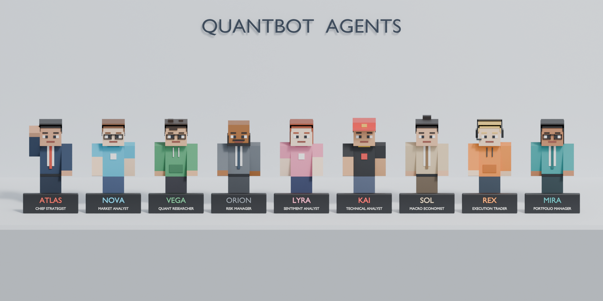
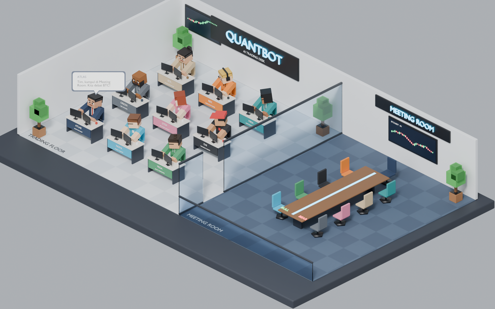
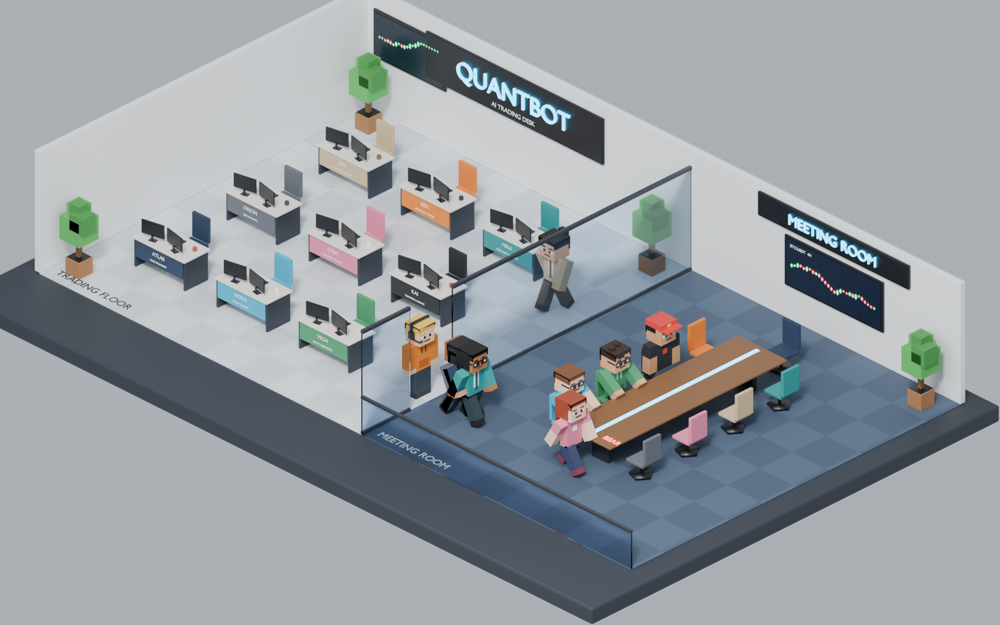
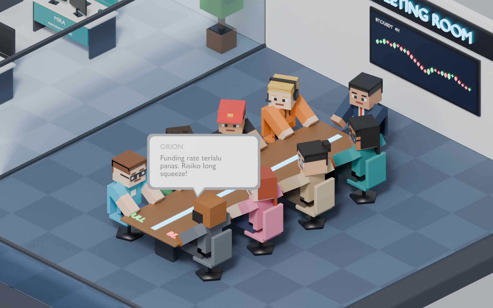

# QUANTBOT: Kantor 9 Agen Trading AI (gaya Minecraft)



| Kerja di meja | Berjalan ke Meeting Room | Debat |
|---|---|---|
|  |  |  |

## File

| File | Fungsi |
|---|---|
| `quantbot_office.blend` | Scene jadi (Blender 4.2+ / 5.x), tinggal buka lalu tekan Play |
| `build_quantbot_office.py` | Generator scene (memakai helper dari `build_office_miniature.py`) |
| `quantbot_agents.json` | Agen (nama, peran, kubu, tampilan), obrolan di meja, dan naskah debat |

Bangun ulang dari terminal:

```bash
blender --background --python build_quantbot_office.py -- \
  --save quantbot_office.blend \
  --render desks.png --frame 30 --render-lineup lineup.png
```

## Agen

| ID | Peran | Kubu debat | Ciri |
|---|---|---|---|
| ATLAS | Chief Strategist | moderator (kepala meja) | jas navy, dasi merah |
| NOVA | Market Analyst | bull | kacamata, kaos cyan |
| VEGA | Quant Researcher | bull | rambut berantakan, hoodie hijau, kacamata |
| ORION | Risk Manager | bear | botak berjenggot, jas abu |
| LYRA | Sentiment Analyst | bear | rambut panjang merah, kaos pink |
| KAI | Technical Analyst | bull | topi merah, kaos hitam |
| SOL | Macro Economist | bear | rambut dicepol, jas krem |
| REX | Execution Trader | netral | headset, hoodie oranye |
| MIRA | Portfolio Manager | netral | rambut panjang, blazer teal, kacamata |

## Rig karakter

Setiap agen terdiri dari satu armature (nama objek = ID agen) dan satu mesh `<ID>_body`
yang di-skin per bagian, mirip model Minecraft:

- tulang `root` (gerak naik/turun badan, dipakai saat duduk), `body`, `head`,
  `arm.L`, `arm.R`, `leg.L`, `leg.R`;
- proporsi skin Minecraft: 1 piksel = 5.6 cm, tinggi 1.79 m, menghadap -Y;
- rotasi X negatif pada lengan atau kaki = mengayun ke depan; duduk = kaki -90°
  dan `root` turun 0.34 m;
- custom properties `agent_id`, `role`, `camp` ada di objek armature.

Action siap pakai (fake user, bisa dipasang di NLA atau diekspor ke game engine):
`QB_Idle`, `QB_Walk` (loop 16 frame), `QB_Sit_Down`, `QB_Sit_Typing`, `QB_Sit_Talk`,
`QB_Sit_Listen`. Semua agen memakai nama tulang yang sama, jadi action-nya bisa
dipakai di agen mana pun.

## Animasi demo (frame 1-1204, 24 fps)

1. Frame 1-90: semua mengetik di meja. ATLAS memanggil rapat dan REX menjawab.
2. Mulai frame 94: agen berdiri bergantian, berjalan lewat lorong dan pintu kaca,
   lalu duduk di Meeting Room. Kubu bull duduk di sisi barat, kubu bear di sisi timur.
3. Mulai frame 520: debat 10 giliran. Yang bicara menggerakkan tangan, yang lain
   menoleh ke arahnya.

Kamera berganti otomatis lewat timeline marker: `Iso_Camera` untuk seluruh kantor,
lalu `Debate_Camera` yang lebih dekat ke meja debat mulai frame 512.

## Chat bubble

Setiap ucapan adalah satu Empty `Bubble_<nn>_<ID>` di collection `Chat_Bubbles`,
dengan child berupa gelembung putih bersudut bulat, border warna agen, nama agen,
dan teks pesan. Bubble:

- menempel ke tulang `head` sehingga ikut bergerak bersama agen;
- selalu menghadap kamera lewat constraint Copy Rotation;
- muncul dengan efek pop (scale 0 -> 1.12 -> 1) lalu hilang lagi.

Template ada di collection `QB_Assets` (disembunyikan). Untuk mengubah dialog,
edit `desk_chatter` dan `debate` di JSON, lalu jalankan ulang script. Waktu
bicara dan arah tolehan agen dihitung ulang otomatis.

## Scene lain

`Character_Lineup` berisi 9 agen berjajar dengan papan nama. Pilih scene ini dari
selector Scene di kanan atas Blender.
