# QUANTBOT HQ: kantor dua lantai bergaya Minecraft

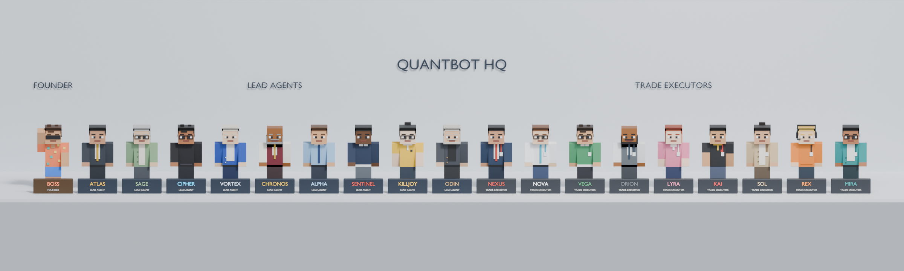

| Eksterior | Gedung (atap dibuka) |
|---|---|
| 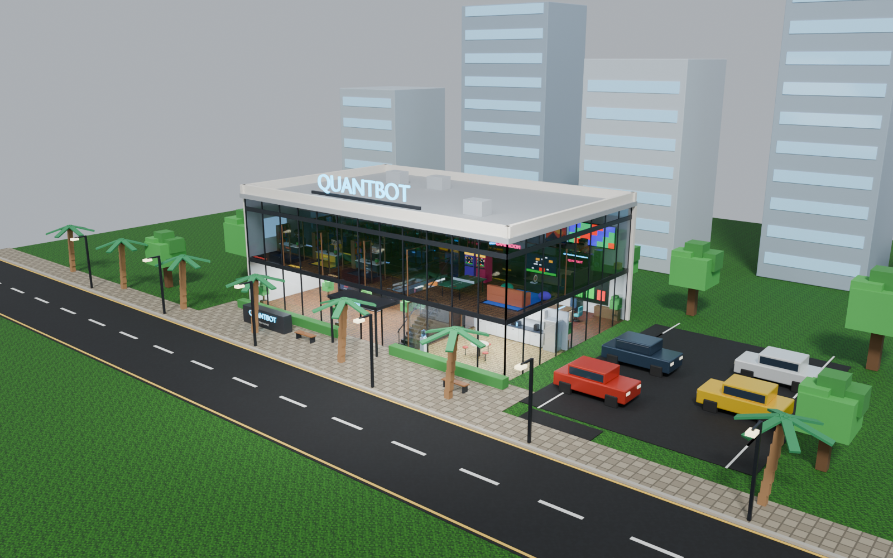 | 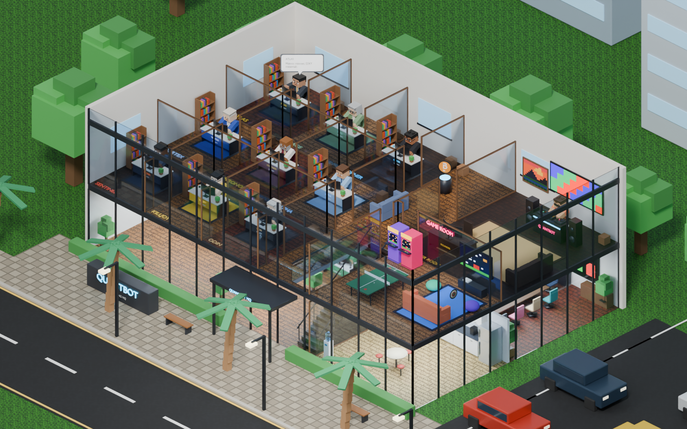 |

| Lantai 1 | Lantai 2 |
|---|---|
| 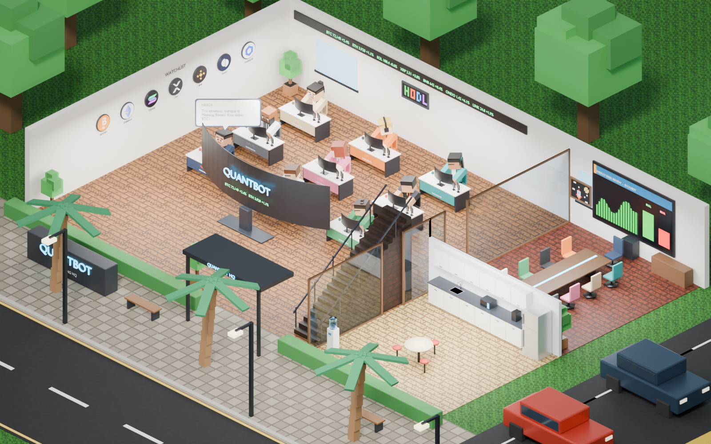 | 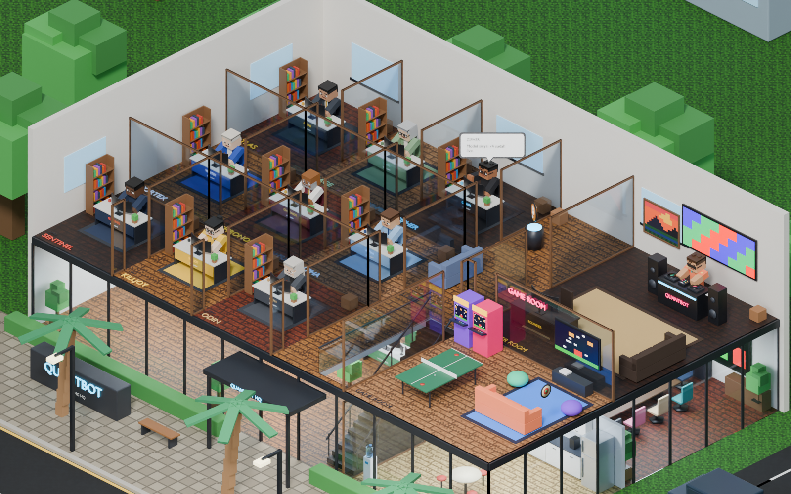 |

| Trading Floor | Meeting Room (debat) | Pantry |
|---|---|---|
| 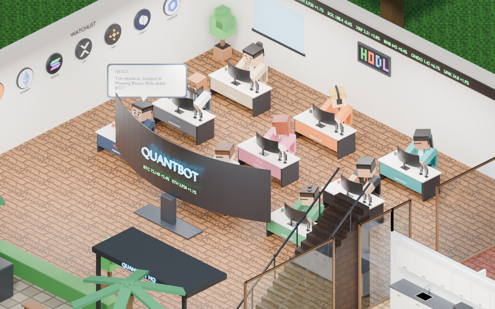 | 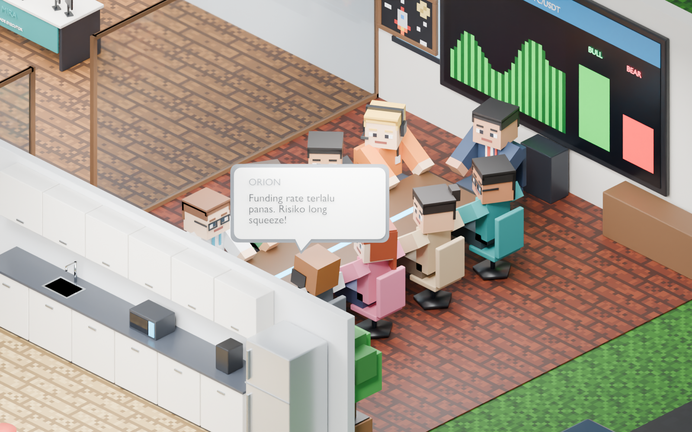 | 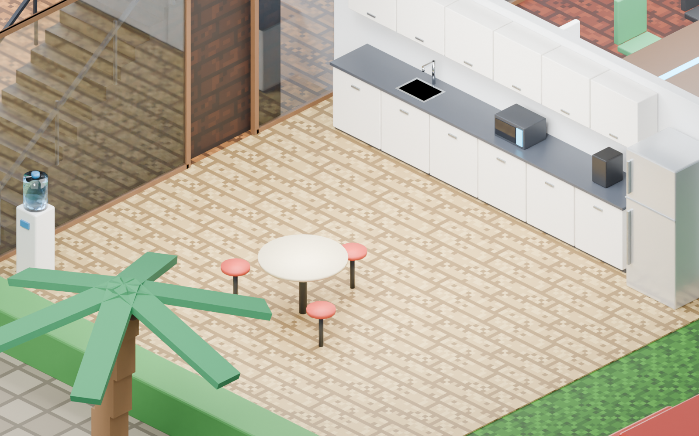 |

| Ruang Owner + set DJ | Game Room | Ruang Lead ATLAS |
|---|---|---|
| 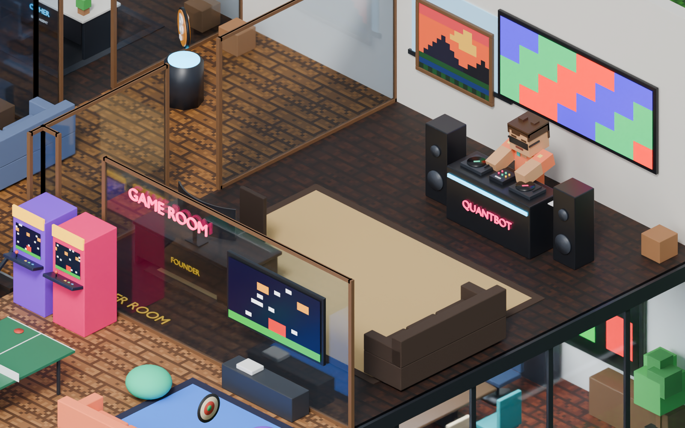 | 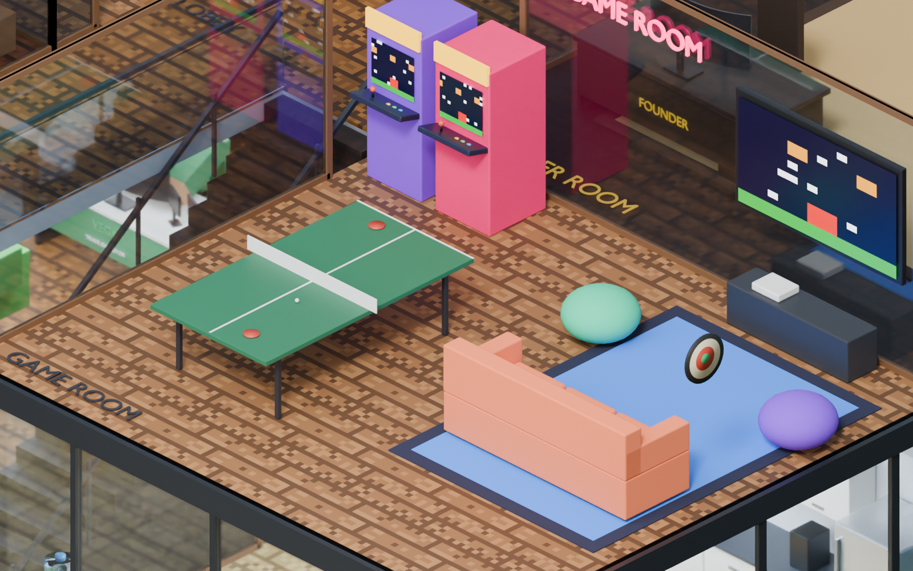 | 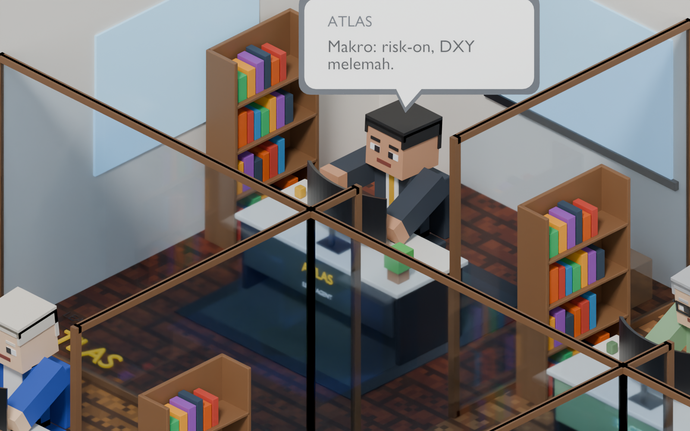 |

## File

| File | Fungsi |
|---|---|
| `quantbot_hq.blend` | Scene jadi (Blender 4.2+ / 5.x): buka, tekan N, pakai tab **QUANTBOT** |
| `build_quantbot_hq.py` | Generator gedung, eksterior, ruangan, karakter, dan animasi |
| `quantbot_hq.json` | Owner, 9 Lead, 9 Trade Executor, obrolan, dan naskah debat |
| `quantbot_viewer_panel.py` | Panel sidebar Blender (ikut tersimpan di dalam `.blend`) |
| `web/` | Viewer 3D di browser: `index.html`, `quantbot_hq.glb`, jadwal, dan decoder Draco |

Bangun ulang semuanya:

```bash
blender --background --python build_quantbot_hq.py -- \
  --save quantbot_hq.blend --glb web/quantbot_hq.glb \
  --schedule web/quantbot_hq_schedule.json \
  --render CAM_TradingFloor:trading.png:40 --render-lineup lineup.png
```

## Denah

**Lantai 1**

- **Trading Floor**: 9 meja Trade Executor. Setiap meja punya curved monitor ultrawide, terminal Bloomberg (dua layar oranye dan keyboard dengan tombol kuning, merah, hijau), serta papan nama. Di tengah ruangan ada video wall melengkung yang menghadap meja-meja. Dinding kiri memuat WATCHLIST (BTC, ETH, SOL, XRP, BNB, ONDO, LINK), dinding belakang memuat ticker LED dan banner HODL.
- **Meeting Room** (di sebelah Trading Floor): meja debat kubu BULL vs BEAR untuk 9 kursi, plus LCD besar 4,2 m sebagai papan tulis presentasi (chart dan judul slide).
- **Pantry** (di samping Meeting Room): lemari pantry atas dan bawah, wastafel dengan keran air, microwave, mesin kopi, kulkas dua pintu, dispenser galon, dan meja makan bundar dengan tiga bangku.
- **Tangga** ke lantai 2 dan **pintu masuk** berkanopi di depan.

**Lantai 2**

- **9 ruang Lead**: ATLAS, SAGE, CIPHER, VORTEX, CHRONOS, ALPHA, SENTINEL, KILLJOY, dan ODIN. Setiap ruang berisi meja dengan curved monitor, rak buku, tanaman, karpet, dan papan nama di lantai.
- **Ruang Owner (FOUNDER ROOM)**: lebih besar dari ruang Lead. Isinya set DJ lengkap (dua turntable yang piringannya berputar, mixer, speaker, LED wall), meja kerja eksekutif dengan kursi dan curved monitor 1,35 m, sofa, serta lukisan pixel.
- **Game Room** (di sebelah ruang Owner): 2 mesin arcade, meja ping pong, sofa dengan TV dan konsol, beanbag, papan dart, dan neon GAME ROOM.
- **Lobby** dengan hologram koin BTC berputar.

**Eksterior**: rumput, plaza berpaving, monumen logo QUANTBOT, jalan raya dengan marka, trotoar, palem, lampu jalan, parkiran dengan 4 mobil, pohon blok, pagar tanaman, dan gedung tetangga. Fasad depan dan kanan berupa kaca dengan rangka hitam. Atapnya punya papan QUANTBOT dan unit AC; atap disembunyikan default supaya isi lantai 2 terlihat.

Semua lantai ruangan memakai tekstur papan kayu pixel 16×16 seperti Minecraft (oak, walnut, birch, teak, ash), dengan warna berbeda per ruangan.

## Karakter

- **Owner (BOSS)**: kemeja Hawaii motif bunga, celana pendek, sandal, dan kacamata hitam. Berdiri di booth DJ dan bergoyang mengikuti musik.
- **9 Lead** (lantai 2): setiap Lead memakai pakaian kantor yang berbeda, yaitu jas, kardigan, turtleneck, blazer, rompi, kemeja dan dasi, sweater, polo, atau blazer gelap.
- **9 Trade Executor** (lantai 1): pakaian kantor yang berbeda lagi, ditambah ID card dan lanyard. Executor yang dulu bernama ATLAS sekarang bernama **NEXUS** supaya tidak tertukar dengan Lead ATLAS. Namanya bisa diganti di `quantbot_hq.json`.

Rig setiap agen sama: `root`, `body`, `head`, `arm.L/R`, `leg.L/R`. Action siap pakai yang tersedia: `QB_Idle`, `QB_Walk`, `QB_Sit_Down`, `QB_Sit_Typing`, `QB_Sit_Talk`, `QB_Sit_Listen`.

## Animasi demo (frame 1-1257, 24 fps, sekitar 52 detik)

- **Lantai 1**: Executor mengetik, lalu NEXUS memanggil rapat. Mereka berjalan ke Meeting Room, duduk, dan berdebat 10 giliran mulai frame 573. Yang bicara menggerakkan tangan, yang lain menoleh ke arahnya.
- **Lantai 2**: Lead bekerja di ruangnya dan bergantian melapor lewat chat bubble. BOSS ber-DJ dan sesekali ikut bicara.

## Melihat aktivitas secara live

**Di Blender**: buka `quantbot_hq.blend`, izinkan *Auto Run Python Scripts* (atau buka Text Editor lalu Run Script pada `quantbot_viewer_panel.py`), tekan **N**, lalu buka tab **QUANTBOT**. Isi panelnya:

- tombol ruangan: pindah kamera, dan lantai atau fasad yang menghalangi otomatis disembunyikan;
- slider **Zoom** yang langsung mengubah zoom kamera aktif;
- centang Eksterior, Lantai 1, Lantai 2, Atap, dan Kaca fasad;
- tombol Play / Pause.

Animasi berjalan real-time di viewport (mode Material Preview atau Solid). Mouse wheel dan zoom viewport biasa juga tetap bisa dipakai.

**Di browser**: buka `web/index.html` lewat web server (atau versi Artifact yang sudah dipublikasikan). Isinya:

- zoom dengan scroll atau pinch, putar dengan drag, geser dengan klik kanan atau dua jari;
- tombol per ruangan dan per Lead;
- **Feed live** yang mencatat setiap ucapan agen; klik sebuah pesan untuk terbang ke agen tersebut;
- tab **Agen**: klik nama agen untuk mengikutinya ke mana pun ia berjalan;
- timeline yang bisa digeser, serta kecepatan 0,5× sampai 4×.
