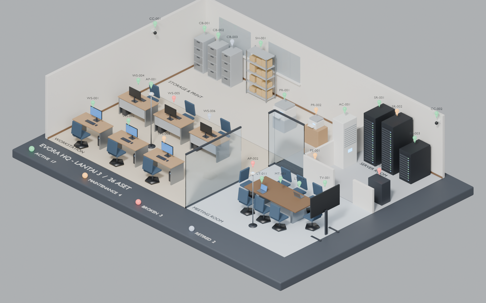

# Miniatur 3D Office Asset Management (Blender)

Diorama kantor isometrik yang dibangun otomatis dari data inventaris aset.
Setiap aset punya model 3D low-poly, pin status berwarna, dan label ID.



## Isi folder

| File | Fungsi |
|---|---|
| `office_assets.json` | Data kantor: ukuran ruang, zona, partisi, warna status, dan daftar aset |
| `build_office_miniature.py` | Script Blender yang membaca JSON lalu membangun scene |
| `office_asset_miniature.blend` | Hasil jadi, bisa langsung dibuka di Blender 4.2+ / 5.x |
| `preview.png` | Render Cycles 1920x1200 |

## Cara pakai

Buka langsung: `office_asset_miniature.blend`.

Bangun ulang dari GUI: Blender > tab Scripting > Open `build_office_miniature.py` > Run Script.
JSON dibaca dari folder yang sama dengan script (atau folder file `.blend`).

Bangun ulang dari terminal:

```bash
blender --background --python build_office_miniature.py -- \
  --save office_asset_miniature.blend \
  --render preview.png --samples 64 --res 1920x1200
```

## Isi scene

Zona: Workstation, Meeting Room, Server Room, Storage & Print, dengan partisi kaca
dan dinding internal yang dipotong rendah (gaya cutaway) supaya isi ruangan terlihat.

Tipe aset yang didukung: `workstation`, `laptop`, `meeting_table`, `display`,
`server_rack`, `ups`, `ac_unit`, `printer`, `cabinet`, `shelf`, `access_point`,
`cctv`, `fire_extinguisher`.

Warna pin status: hijau `active`, oranye `maintenance`, merah `broken`, abu-abu `retired`.

Struktur di Outliner:

- `Assets/Assets_<ZONA>`: satu Empty per aset bernama ID aset (mis. `WS-003`), semua
  bagian model menjadi child-nya. Data aset tersimpan sebagai custom properties
  (`name`, `type`, `zone`, `status`, `owner`, `purchase`, `value_idr`); lihat di
  panel N > Item atau Object Properties > Custom Properties.
- `Status_Markers`: pin + label; matikan collection ini untuk tampilan bersih.
- `Zones`, `Office_Shell`, `Legend`.
- Ringkasan (`asset_total`, `asset_value_idr`, `asset_<status>`) ada di custom
  properties Scene.

## Menambah atau mengubah aset

Tambahkan entri di `assets` pada JSON, lalu jalankan ulang script:

```json
{"id": "LT-013", "type": "laptop", "name": "Dell Latitude 5440", "zone": "MTG",
 "pos": [2.6, -1.45], "rot": 180, "status": "active", "owner": "Nama",
 "purchase": "2025-03-01", "value_idr": 17000000}
```

`pos` dalam meter dengan titik (0, 0) di tengah lantai (lebar 12 m pada sumbu X,
kedalaman 8 m pada sumbu Y). `rot` dalam derajat; pada `rot: 0` bagian depan aset
menghadap -Y (ke arah depan diorama). Zona bisa diberi `label_pos` bila labelnya
tertutup furnitur. Tipe yang tidak dikenal dilewati dengan pesan `[skip]` di konsol.

## Proyek lain di folder ini

- [QUANTBOT HQ](QUANTBOT_HQ.md): kantor dua lantai + eksterior. Trading Floor dengan 9 Trade Executor,
  Meeting Room, Pantry, 9 ruang Lead, ruang Owner dengan set DJ, Game Room, viewer live di Blender dan browser.
- [QUANTBOT v1](QUANTBOT.md): versi satu lantai sebelumnya (9 agen, Meeting Room, chat bubble).
